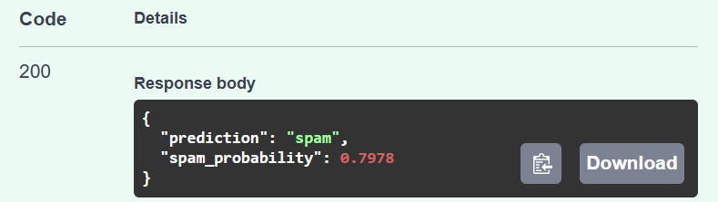
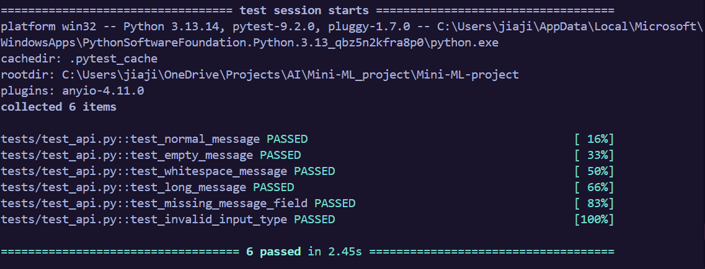

## Secure Spam Detection API
A machine learning-based SMS spam detection system developed using Python, scikit-learn, and FastAPI.

This project classifies SMS messages as **spam** or **ham** (legitimate messages). It also demonstrates basic API security practices, including input validation and automated testing.

## 1. Project Objectives
- Build a machine learning model for SMS spam classification.
- Apply text preprocessing using TF-IDF.
- Train and evaluate a Multinomial Naive Bayes classifier.
- Deploy the trained model through a FastAPI endpoint.
- Implement basic input validation and automated API tests.
- Practise Git version control and technical documentation.

## 2. Technologies Used
- Python
- Pandas
- scikit-learn
- Multinomial Naive Bayes
- TF-IDF Vectorizer
- FastAPI
- Pydantic
- Joblib
- Pytest
- KaggleHub
- Git and GitHub

## 3. Dataset
Dataset: SMS Spam Collection

Source:
https://www.kaggle.com/datasets/uciml/sms-spam-collection-dataset

The dataset contains SMS messages labelled as:
- `ham`: Legitimate messages
- `spam`: Unwanted or suspicious messages

The dataset is downloaded programmatically using KaggleHub.

### Data Preprocessing
The following preprocessing steps were implemented:
1. Selected the relevant columns (`v1` and `v2`).
2. Renamed them to `label` and `text`.
3. Removed missing values.
4. Removed duplicate records.
5. Removed empty or whitespace-only messages.

## 4. Machine Learning Approach
### Feature Extraction
TF-IDF (Term Frequency-Inverse Document Frequency) converts text messages into numerical features.

### Classification
Multinomial Naive Bayes is used to classify messages as spam or ham.

### Training
The cleaned dataset is divided into:
- 80% training data
- 20% testing data

Stratified splitting is used to preserve the approximate class distribution.

## 5. Model Evaluation
The model is evaluated using:
- Accuracy
- Precision
- Recall
- F1-score
- Confusion Matrix

### Results
The Multinomial Naive Bayes model was evaluated using a test set of 1,115 SMS messages.

| Metric | Result |
|--------|--------|
| Accuracy | 96.05% |
| Spam Precision | 1.00 |
| Spam Recall | 0.70 |
| Spam F1-score | 0.83 |

### Confusion Matrix

| Actual / Predicted | Ham | Spam |
|:------------------:|----:|-----:|
| Ham | 966 | 0 |
| Spam | 44 | 105 |

### Results and Limitations
The model achieved an overall accuracy of 96.05%. It correctly classified all 966 legitimate messages in the test set, with no false positives.

However, the model incorrectly classified 44 spam messages as legitimate, resulting in a spam recall of 0.70. This indicates that the model is **more effective** at **avoiding false spam alerts** than detecting every spam message.

Although the **overall accuracy is high**, the results demonstrate why precision, recall, and the confusion matrix are important when evaluating a spam detection system.

`Future improvements` could include adjusting the classification threshold, comparing alternative algorithms, and evaluating the model on more recent SMS data.

## 6. API Implementation
The trained machine learning pipeline is served using FastAPI.

### Endpoint
`POST /predict`

#### Example request:
```json
{
  "text": "Congratulations! You have won a free prize!"
}
```

Example response format:


The response above is illustrative. Actual predictions and probabilities depend on the trained model.

Interactive API documentation is available at:
`http://127.0.0.1:8000/docs`

## 7. Cybersecurity Measures

### Input Validation
The API uses Pydantic to validate incoming requests.

Implemented checks include:
- Rejecting empty messages.
- Rejecting whitespace-only messages.
- Limiting message length to 1,000 characters.
- Rejecting missing or invalid input fields.

### Privacy
The application is designed to classify messages without intentionally storing submitted message contents in a database.

Additional privacy considerations would be required before deploying the API publicly.

### Model Security
The application loads a locally generated model using Joblib. Model files should only be loaded from trusted sources.

### Security Limitations

The current prototype does not implement:
- Authentication and authorisation
- Rate limiting
- HTTPS deployment
- Production monitoring
- Comprehensive security or penetration testing

These are areas for future development.

## 8. Automated Testing
API tests are implemented using Pytest and FastAPI TestClient.

Tests cover:
1. Valid message requests
2. Empty messages
3. Whitespace-only messages
4. Oversized messages
5. Missing fields
6. Invalid input types

Run the tests using:
```bash
python -m pytest tests/test_api.py -v
```



**Test Results:** All 6 automated tests passed successfully using `Pytest`.

The tests verified normal API responses and input validation for empty messages, whitespace-only messages, oversized messages, missing fields, and invalid data types. These results demonstrate that the implemented validation controls behave as expected under the tested conditions.

## 9. Installation and Setup
### Clone the Repository
```bash
git clone https://github.com/JiajyStudio/Secure-Spam-Detection-API
cd secure-spam-detection-api
```

### Create a Virtual Environment
```bash
python -m venv .venv
```

Activate it on Windows PowerShell:
```powershell
.\.venv\Scripts\Activate.ps1
```

### Install Dependencies
```bash
python -m pip install -r requirements.txt
```

### Train the Model
```bash
python train_model.py
```
This downloads the dataset, trains the classifier, evaluates its performance, and saves the trained pipeline.

### Start the API

```bash
python -m uvicorn main:app --reload
```

Open: http://127.0.0.1:8000/docs

## 10. Project Structure
```text
secure-spam-detection-api/
|-- models/
│   |-- spam_model.joblib
|-- tests/
│   |-- test_api.py
|-- train_model.py
|-- main.py
|-- requirements.txt
|-- .gitignore
|-- README.md
```

The trained model is generated by running `train_model.py`.

## 11. Ethical Considerations
Spam detection systems can produce incorrect classifications.

A false positive may cause a legitimate message to be incorrectly identified as spam, while a false negative may allow unwanted messages through.

The dataset may also have limitations relating to language, age, and representativeness.

This prototype is intended for educational purposes and should not be treated as a production-ready security solution.

## 12. Future Improvements
- Compare Naive Bayes with Logistic Regression.
- Improve detection of unfamiliar spam patterns.
- Add authentication and rate limiting.
- Implement GitHub Actions for continuous integration.
- Containerise the application using Docker.
- Evaluate the system on newer and more diverse messages.
- Add monitoring and improve model reliability.

## 13. Learning Outcomes
This project provides practical experience in:
- Machine learning model development and evaluation
- Text classification and feature extraction
- Backend API development
- Input validation and automated testing
- Git version control
- Responsible AI and cybersecurity considerations

## Author

**Onphimol Krurjark**
Bachelor of Artificial Inteeligence
University of Technology Sydney (UTS)

GitHub: [JiajyStudio](https://github.com/JiajyStudio)